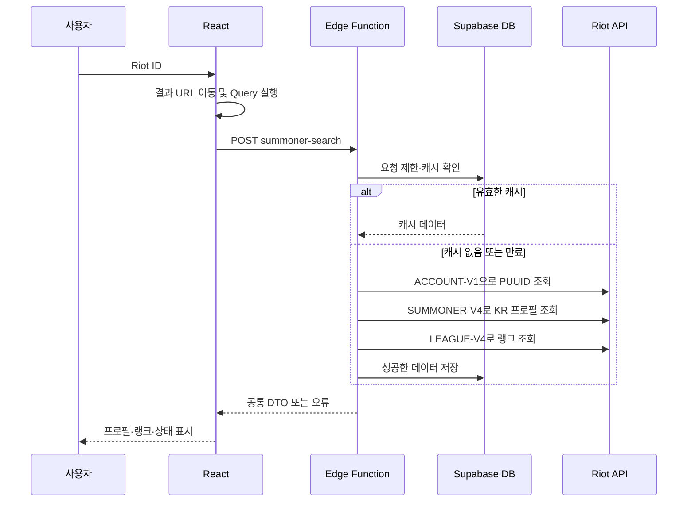

# 소환사 검색 기능 개발 설계 · v0.1

작성일: 2026-11-03  
상태: 검색·프로필·랭크·수동 갱신 구현 반영, 운영 환경 검증 대기

구현률: 기능별 점검표 기준 60% → 95% (19/20). [완료 항목과 남은 운영 검증](./RiftGG_Summoner_Search_Progress.md) 참조. 원래 설계 내용은 아래에 유지한다.
기준: PRD v0.2 §3.1·3.2, 기술 설계 v0.2, `RiftGG_Design_Themes.html`

## 1. 목표와 첫 구현 범위

**로그인하지 않은 사용자가 `Riot ID#태그라인`을 검색하고, 공유 가능한 페이지에서 실제 프로필과 랭크를 확인한다.**

PRD §3.1은 검색·한국 서버·URL 공유·로딩·계정 없음 처리를 요구한다. 첫 배포에서 검색 결과의 가치를 확인할 수 있도록 §3.2의 프로필과 랭크까지 연결한다.

| 이번 구현에 포함 | 다음 구현으로 분리 |
| --- | --- |
| Riot ID와 태그라인 입력, 한국 서버 고정 | 다중 서버, 자동완성, 최근 검색 기록 |
| 검색 결과 이동·직접 URL 접속·새로고침 | 최근 20경기·경기 상세·통계 |
| 이름·태그라인·아이콘·레벨 | 로그인·즐겨찾기·마이페이지 |
| 솔로·자유 랭크 티어·LP·승패·승률 | 경기 필터 및 챔피언 통계 |
| 로딩·빈 상태·오류·수동 갱신 | 운영 지표를 바탕으로 한 고급 캐시 최적화 |

분리한 P0 기능은 이후 MVP 구현 항목으로 남는다. 디자인의 예시 경기와 통계는 실제 서비스 화면에 하드코딩하지 않는다.

## 2. 디자인 적용

**블랙 시안을 확정 디자인으로 사용한다 (사용자 결정: 2026-11-03).** 첫 구현은 블랙 테마를 기준으로 진행한다. 화이트 시안은 비교 참고 자료로 보관하고, 테마 전환 기능은 이번 구현 범위에서 제외한다.

| 요소 | 구현 방식 |
| --- | --- |
| 헤더 | `rift.gg`, League of Legends 문구, `KR · 한국`. 단일 서버를 불필요한 선택 메뉴로 만들지 않는다. |
| 메인 `/` | 시안의 여백·검색창·문구를 확장해 검색 중심 화면으로 구성한다. 메인 화면 배치는 상세 시안에서 파생한 제안이다. |
| 상세 검색창 | 시안의 우측 상단 검색창 재사용. 모바일에서는 제목 아래 전체 너비. |
| 프로필 | 실제 프로필 아이콘, 레벨 배지, Riot ID와 태그라인, 마지막 갱신 시각 표시. |
| 랭크 | 솔로·자유 랭크 카드. 데스크톱 왼쪽 222px, 모바일 상단 2열을 기본으로 좁은 화면에서 재배치. |
| 오른쪽 본문 | 경기 기능이 구현되기 전에는 랭크 요약과 검색 안내로 구성. 가짜 경기·KDA·승률은 표시하지 않는다. |
| 갱신 버튼 | `전적 갱신` 대신 이번 범위에 맞는 `정보 갱신`. 경기 갱신 구현 후 명칭 확장. |
| 즐겨찾기 | 인증·저장 기능 구현 시 추가. 첫 배포에서 동작하지 않는 버튼은 노출하지 않는다. |

디자인 토큰은 블랙 시안에서 추출해 `src/styles/tokens.css`에 정의한다. 아래 화이트 값은 비교 참고용이며, 구현에는 블랙 값을 적용한다.

| 토큰 | 화이트 | 블랙 |
| --- | --- | --- |
| background | `#ffffff` | `#0b0c0e` |
| surface | `#ffffff` | `#111316` |
| surfaceMuted | `#f6f7f9` | `#191c21` |
| text | `#171b24` | `#f0f1f4` |
| textMuted | `#737b8b` | `#969daa` |
| border | `#e9ecf1` | `#25292f` |
| accent | `#4968ef` | `#8b9aff` |

실제 글자 크기에서 대비를 확인하고 필요한 토큰은 조정한다. 모바일 최소 폭 320px, 540px·760px 전환을 기준으로 검증한다. 아이콘은 Lucide React, 프로필 이미지는 Data Dragon을 사용한다. 이미지 실패 시 중립적인 대체 아바타를 표시한다.

## 3. 검색 UX와 URL

### 입력 규칙

- 한 개의 입력창에서 `Riot ID#태그라인` 형식으로 받는다. 예: `Rift Player#KR1`.
- Enter와 검색 버튼으로 제출한다. 타이핑 중 API 호출이나 자동완성 요청은 하지 않는다.
- 전체·각 항목의 앞뒤 공백만 정리하고 Unicode NFC 정규화한다. 이름 내부 공백과 원래 대소문자는 보존한다.
- `#` 구분자 하나와 비어 있지 않은 두 항목을 요구한다. 제어문자를 거부한다. 태그가 없으면 `#태그라인까지 입력해주세요`를 표시하며 `KR1`을 자동 보충하지 않는다.
- 한국 서버는 태그라인이 아니라 요청의 `platform: "kr"`로 결정한다. `KR1` 이외의 태그도 검색할 수 있다.
- 요청 크기 제한을 둔다. 초기 방어 한도는 이름 128·태그 64 Unicode 코드 포인트, 요청 본문 2KB로 제안한다. 이는 Riot ID의 공식 생성 규칙이 아니라 서비스 입력 보호 한도다. 과도한 정규식으로 유효한 계정을 차단하지 않는다.
- 한글 IME 조합 중 Enter는 제출하지 않는다. 프론트와 함수에서 같은 검증 사례를 실행한다.

### 결과 URL

```text
/                          메인 검색 화면
/summoners/kr?gameName=Rift+Player&tagLine=KR1
```

URL 생성은 `URLSearchParams`로 처리한다. `#`는 URL fragment로 사용하지 않으며 이름·태그를 직접 문자열 연결하지 않는다. URL이 검색 조건의 기준이고 입력 중인 텍스트는 폼의 로컬 상태다.

1. 폼을 검증한다.
2. URL로 이동한다. 이 단계에서 별도 조회를 실행하지 않는다.
3. 상세 페이지가 URL을 읽고 Query를 실행한다. 같은 데이터를 두 번 요청하지 않는다.
4. API가 반환한 정식 이름·태그가 URL과 다르면 `replace`로 정규 URL을 반영하고 Query 캐시를 함께 채운다.
5. 공유·새로고침·뒤로 가기도 URL을 통해 같은 조회를 복원한다.

잘못된 URL 파라미터는 Riot 호출 전에 입력 오류로 표시한다. 지원하지 않는 서버는 한국 서버 안내를 표시한다. 배포 시 `/summoners/kr` 직접 접속이 SPA로 연결되도록 Vercel rewrite를 설정한다.

### 화면 상태

| 상태 | 표시·동작 |
| --- | --- |
| 초기 | 입력 예시와 한국 서버 안내 |
| 입력 오류 | 입력 아래 원인 표시, `aria-invalid`·`aria-describedby` 연결 |
| 최초 조회 중 | 프로필·랭크 자리의 스켈레톤, 결과 영역 `aria-busy` |
| 성공 | 실제 데이터와 서버의 `updatedAt` 표시 |
| 랭크 기록 없음 | 정상 200 + 빈 랭크 결과일 때만 `언랭크` |
| 랭크 조회 실패 | 프로필은 표시하고 `랭크 정보를 불러오지 못했습니다` 안내. 언랭크와 구분 |
| 갱신 중 | 기존 결과 유지, 버튼 비활성화·스피너 |
| 다른 계정 검색 | 이전 계정 프로필을 새 계정의 결과처럼 표시하지 않고 새 스켈레톤 표시 |
| 계정 없음 | Riot ID 확인 안내, 입력값 유지 |
| 한국 서버 정보 없음 | 계정은 있으나 KR LoL 프로필을 찾지 못했다는 별도 안내 |
| 일시 오류·제한 | 재시도 안내와 가능한 경우 대기 시간 표시 |

검색 후 결과 제목으로 포커스를 이동한다. 오류·완료는 `aria-live="polite"`로 알리고 색상만으로 상태를 구분하지 않는다. 중복 제출은 막되 새 계정 검색은 가능하도록 한다.

## 4. 프론트엔드 구조

React Router, TanStack Query, supabase-js, Zod, lucide-react를 사용한다. Zustand는 이번 기능에 필요하지 않다. 확정 기술 사양에 따라 Tailwind CSS v4를 적용했으며 `styles/tokens.css`의 `@theme`에서 블랙 테마를 관리한다.

```text
src/
  app/                    # Router, QueryClientProvider
  pages/
    HomePage.tsx
    SummonerPage.tsx
    NotFoundPage.tsx
  features/summoner-search/
    components/
      SummonerSearchForm.tsx
      SummonerProfile.tsx
      RankCard.tsx
      SummonerSkeleton.tsx
      SummonerError.tsx
      SummonerRefreshButton.tsx
      SummonerWarnings.tsx
    api.ts
    hooks/useSummoner.ts
    riotId.ts              # parse / normalize / URL builder
  lib/supabase.ts
  styles/tokens.css
supabase/
  config.toml
  migrations/
  functions/
    summoner-search/index.ts
    _shared/              # Riot client, validation, errors, cache, contracts
```

공통 요청·응답 타입은 `supabase/functions/_shared/contracts.ts`, 서버 저장소 인터페이스는 `summoner-search/store.ts`에서 관리한다.

- Query key: `['summoner', 'kr', normalizedGameName, normalizedTagLine]`. Riot의 대소문자 비교 규칙을 확인하기 전에는 이름을 임의로 소문자화하지 않는다.
- `staleTime`은 최대 60초를 초기값으로 삼고 서버 캐시의 남은 유효 시간을 상한으로 적용한다. 창 포커스 복귀 시 자동 재조회는 초기에는 끈다.
- 자동 재시도는 초기에는 끈다. 400·404·429 재시도 루프를 방지하고 명시적인 재시도 버튼을 제공한다.
- 이름·태그 변경은 다른 Query로 처리한다. 오래된 응답이 현재 검색 결과를 덮지 않도록 한다. API 래퍼가 AbortSignal을 전달할 수 있게 만든다.
- 조회 Query와 강제 갱신 Mutation을 분리한다. 갱신 성공 결과는 같은 Query key에 반영한다. `forceRefresh`를 Query key에 포함하지 않는다.
- Function의 비2xx 응답도 JSON 본문의 오류 코드를 읽어 공통 오류로 변환한다. HTTP 상태만으로 안내 문구를 결정하지 않는다.

## 5. Supabase API 계약

공개 조회 Function `summoner-search`를 만든다. API 래퍼에서 `supabase.functions.invoke`로 호출하고, 브라우저는 Riot API나 캐시 테이블에 직접 접근하지 않는다.

```http
POST /functions/v1/summoner-search
Content-Type: application/json

{
  "platform": "kr",
  "gameName": "Rift Player",
  "tagLine": "KR1",
  "forceRefresh": false
}
```

아래 계약을 TypeScript 타입과 Zod 스키마로 먼저 확정한다.

```ts
type Rank = {
  tier: string
  division: string | null
  lp: number
  wins: number
  losses: number
}

type SummonerSearchResponse = {
  data: {
    puuid: string
    platform: 'kr'
    gameName: string
    tagLine: string
    profileIconId: number
    summonerLevel: number
    ranks: {
      status: 'ready' | 'unavailable'
      solo: Rank | null
      flex: Rank | null
      updatedAt: string | null
    }
  }
  meta: {
    requestId: string
    source: 'cache' | 'riot' | 'stale'
    updatedAt: string
    expiresAt: string
    refreshAllowedAt: string
    warningCodes: string[]
    retryAfterSeconds?: number
  }
}

type ApiError = {
  error: {
    code: string
    message: string
    requestId: string
    retryAfterSeconds?: number
  }
}
```

`status: ready`일 때 `solo: null`이면 솔로 랭크 기록이 없는 정상 결과다. `unavailable`은 조회 실패다. 승률은 `wins / (wins + losses) * 100`으로 계산하며 0경기는 `-`로 표시한다. 모든 티어에 로마 숫자 등급이 있다고 가정하지 않는다.

날짜는 UTC ISO 8601로 반환한다. 프로필과 랭크의 갱신 시각을 구분하고, 캐시 적중이나 조회 실패로 성공 시각을 현재 시각으로 바꾸지 않는다. `expiresAt`은 프로필 캐시 기준이고, 랭크 유효성은 서버에서 별도로 판단한다. `retryAfterSeconds`는 제한·동시 갱신 대기·부분 실패 시 재조회 안내에 사용한다.

## 6. Riot API 호출 순서

Riot ID를 PUUID로 해석한 뒤 이후 조회의 식별자로 사용한다. 한국 서비스에서는 regional host와 platform host를 분리한다. [Riot 공식 설명](https://developer.riotgames.com/docs/lol)



| 용도 | 호스트·엔드포인트 |
| --- | --- |
| 계정 해석 | `asia.api.riotgames.com/riot/account/v1/accounts/by-riot-id/{gameName}/{tagLine}` |
| KR 프로필 | `kr.api.riotgames.com/lol/summoner/v4/summoners/by-puuid/{puuid}` |
| KR 랭크 | `kr.api.riotgames.com/lol/league/v4/entries/by-puuid/{puuid}` |

경로 항목별로 `encodeURIComponent`를 적용한다. 호스트는 서버의 고정 매핑에서 결정하며 사용자 지정 URL을 전달받지 않는다. 키는 `X-Riot-Token` 헤더에 넣는다. 이름은 ACCOUNT-V1 응답을 사용하고 기존 summoner name·summoner ID에 의존하지 않는다.

ACCOUNT 성공 후 KR 프로필을 조회하고, 프로필 404면 랭크 호출을 생략한다. 처음에는 순서대로 호출하고 측정 후 프로필·랭크 병렬화를 검토한다. 프로필 성공·랭크 실패는 부분 성공 200과 warning으로 표현한다. 빈 랭크 배열은 조회 성공일 때만 언랭크로 저장한다.

각 외부 요청에 타임아웃, Function에 합계 기한을 둔다. 초기 제안은 각 3초·합계 10초다. 429의 `Retry-After` 동안 공유 쿨다운을 적용하고 해당 호출 범위의 새로운 외부 요청을 중단한다. 함수 안에서 장시간 대기하거나 무제한 재시도하지 않는다. [공식 오류·429 처리](https://developer.riotgames.com/docs/portal)

Riot API Reference는 동적 페이지여서 이번 조사에서 DTO 전체를 추출하지 못했다. 구현 시작 시 개발 키로 세 엔드포인트의 성공·404·빈 랭크 응답을 확인하고, 실제 응답 fixture와 Zod 스키마를 확정한다. 특히 LEAGUE-V4의 PUUID 버전을 확인하고 오래된 summoner ID 버전에 의존하지 않는다. [공식 API Reference](https://developer.riotgames.com/apis), [Riot 공식 저장소의 PUUID 전환 안내](https://github.com/RiotGames/developer-relations/issues/1092)

Data Dragon 버전은 서버 설정 또는 주기적으로 갱신하는 manifest에서 관리한다. 검색마다 버전 목록을 요청하지 않는다. 버전과 `profileIconId`로 이미지 URL을 만들고, 이미지 실패는 검색 실패와 분리한다.

## 7. DB·캐시·동시 실행

TTL은 PRD 확정값이 아닌 초기 제안이다. Riot 호출 예산과 실측에 따라 조정한다.

| 테이블 | 키·내용 | 초기 유효 기간 |
| --- | --- | --- |
| `riot_id_lookup_cache` | `(platform, game_name, tag_line)` 고유, PUUID·expires_at | 5분 |
| `summoners` | `(platform, puuid)` 고유, 정식 이름·태그·아이콘·레벨·updated_at·expires_at | 5분 |
| `rank_entries` | `(platform, puuid, queue_type)` 고유, tier·division·LP·wins·losses | 아래 상태 테이블 기준 |
| `rank_cache_state` | `(platform, puuid)` 고유, 갱신 시각·expires_at. 랭크 0건의 조회 성공도 기록 | 5분 |
| `request_limits` / `refresh_leases` | 호출 카운터, Riot 쿨다운, 갱신 소유자·만료 시각 | 용도별 만료·정리 |

- 입력 정규화 키로 이름 캐시를 조회하되 대소문자를 임의로 합치지 않는다. 표기 차이에 따른 추가 miss는 허용한다.
- Riot ID와 PUUID 대응을 영구 고정하지 않는다. lookup 만료·수동 갱신 시 ACCOUNT로 재확인한다. 최대 5분의 캐시 표시 지연을 허용하며, 개명한 뒤에도 과거 URL을 영구적으로 같은 계정에 연결하지 않는다.
- 프로필과 랭크 유효성을 개별 판단하고 유효한 데이터는 다시 호출하지 않는다.
- 랭크 조회 성공 시 대상 두 큐의 snapshot을 트랜잭션으로 교체하고 없어진 큐는 삭제한다. 실패 시 기존 데이터를 지우거나 TTL을 연장하지 않는다.
- 수동 갱신은 PUUID당 60초 쿨다운을 초기값으로 둔다. 버튼뿐 아니라 DB에서도 적용해 다른 이름 표기로 우회하지 못하게 한다.
- 동시 요청은 만료가 있는 DB 리스로 조정한다. 계정 해석은 검색 키, 프로필·랭크는 해석된 `platform + puuid`로 획득 권한을 얻는다. 짧은 RPC로 리스를 얻고 Riot 통신 중에는 DB 트랜잭션을 열어두지 않는다.
- 다른 요청이 갱신 중이면 반환 가능한 기존 데이터를 제공한다. 최초 데이터가 없으면 `REFRESH_IN_PROGRESS`와 짧은 재시도 시간을 반환하고 Riot 요청을 중복 실행하지 않는다.
- 리스 기한은 합계 통신 기한보다 길게 두고 저장할 때 소유자 토큰을 검증한다. 만료된 이전 작업이 새 데이터를 덮어쓰지 못하게 한다.
- 일시적인 Riot 실패에 한해 30분 이내 기존 데이터를 `source: stale`과 경고로 반환하는 초기안을 적용한다. 단, 이름과 PUUID의 대응은 유효한 lookup 또는 이번 ACCOUNT 응답으로 확인되어야 한다. 확인하지 못한 오래된 이름 결과는 반환하지 않는다.
- 404를 오래된 성공 데이터로 숨기지 않는다. 캐시 저장만 실패하면 이번에 얻은 실제 데이터와 경고를 반환한다. 캐시 DB나 공유 제한 저장소 자체에 접속할 수 없으면 Riot 호출을 중단하고 503을 반환한다.

공통 캐시·제한 테이블은 비공개 스키마 또는 RLS와 권한 회수로 보호한다. 브라우저의 anon/authenticated에 읽기·쓰기·관리 RPC 실행을 허용하지 않는다. 관리 RPC는 서버 전용 역할만 실행하도록 SQL 권한을 명시한다.

## 8. 오류 계약

| HTTP / code | 원인 | 사용자 안내 |
| --- | --- | --- |
| 400 `INVALID_RIOT_ID` | 입력 부족·형식 오류 | Riot ID와 태그라인을 확인해주세요 |
| 400 `UNSUPPORTED_PLATFORM` | kr 이외 서버 | 현재 한국 서버를 지원합니다 |
| 404 `ACCOUNT_NOT_FOUND` | ACCOUNT 404 | 해당 Riot ID를 찾을 수 없습니다 |
| 404 `KR_PROFILE_NOT_FOUND` | 계정은 있으나 KR 프로필 404 | 한국 서버의 LoL 프로필을 찾을 수 없습니다 |
| 409 `REFRESH_IN_PROGRESS` | 다른 요청이 조회 중·최초 데이터 없음 | 정보를 가져오고 있습니다. 잠시 후 다시 시도해주세요 |
| 429 `SEARCH_RATE_LIMITED` | 서비스 검색 제한 | 검색이 집중되고 있습니다. 잠시 후 다시 시도해주세요 |
| 429 `REFRESH_COOLDOWN` | 60초 이내 수동 갱신 | 다음 갱신까지 ○초 남았습니다 |
| 429 `RIOT_RATE_LIMITED` | Riot 429 | 조회 한도에 도달했습니다. ○초 뒤 다시 시도해주세요 |
| 503 `UPSTREAM_UNAVAILABLE` | Riot 5xx·키 불량·응답 형식 오류 | 현재 정보를 가져올 수 없습니다 |
| 503 `SERVICE_UNAVAILABLE` | DB·공유 제한 저장소 장애 | 일시적으로 이용할 수 없습니다 |
| 504 `UPSTREAM_TIMEOUT` | 외부 통신 기한 초과 | 정보를 가져오는 데 시간이 걸리고 있습니다 |

랭크만 실패하면 프로필 성공 200에 `ranks.status: unavailable` 또는 유효한 기존 랭크와 warning을 넣는다. 비2xx 오류는 프로필 자체를 반환하지 못하는 경우에 사용한다. 갱신 실패 시 표시 중인 데이터와 최종 성공 시각을 유지하고 경고를 표시한다.

Riot 401/403은 운영 키·권한 오류로 기록하며 사용자에게 로그인을 요구하지 않는다. 로그에는 requestId·처리 단계·상위 API 상태를 남긴다. 키·토큰·상위 API 원문은 사용자에게 반환하지 않는다. 429의 HTTP `Retry-After`와 JSON 대기 시간은 일치시킨다.

## 9. 공개 Function과 요청 제한

- `supabase/config.toml`에서 `[functions.summoner-search]`의 `verify_jwt = false`를 명시해 비로그인 검색을 허용한다. 개인 데이터 Function에는 이 설정을 그대로 적용하지 않는다. [Supabase 공식 설정](https://supabase.com/docs/guides/functions/function-configuration)
- 브라우저 환경변수는 `VITE_SUPABASE_URL`과 publishable key만 사용한다. Riot 키·Supabase 관리 키는 Function Secrets에 둔다.
- `POST`·`OPTIONS`만 허용하고 CORS 출처·헤더·메서드를 명시한다. CORS와 publishable key를 남용 방지 수단으로 취급하지 않는다.
- 이용자별 초기 제안 한도는 30회/분이다. DB의 원자적 카운터로 판정한다. IP를 사용하면 Supabase에서 신뢰할 수 있는 전달 정보를 검증하며, 임의의 X-Forwarded-For를 그대로 믿지 않는다. IP 식별자는 솔트가 있는 해시로 단기 보관한다.
- IP 한도와 별도로 Riot 키 전체·라우팅·메서드별 호출 예산과 쿨다운을 공유한다. Riot 헤더와 실제 키의 허용량을 확인해 설정한다. 외부 호출마다 예산을 원자적으로 예약한다.
- 신뢰할 수 있는 발신 정보가 확정되기 전에도 전체 예산과 동시 호출 제한은 적용한다. IP별 제한을 검증하지 않은 상태에서 구현 완료로 간주하지 않는다. 공개 전 발신 정보·429 제어를 결합 검증한다.

## 10. 구현 순서와 완료 조건

| 단계 | 작업 | 완료 조건 |
| --- | --- | --- |
| 1. 계약·연결 확인 | 개발 키로 3 API 확인, fixture·DTO·오류·입력 규칙 확정 | KR 프로필·랭크·404 재현 |
| 2. UI | Router·테마 토큰·검색 폼·fixture 기반 성공/로딩/오류 화면 | 시안의 밀도·배색 유지, 320px 이상 정상 표시 |
| 3. Supabase | SQL migrations·권한·캐시·리스·공유 제한 | anon/authenticated의 캐시 관리 직접 접근 차단 |
| 4. 연동 | Function·Riot client·DTO 변환·Query·URL 연결 | 실제 검색과 공유 URL 직접 접속 성공 |
| 5. 갱신·장애 | 수동 갱신·부분 성공·429·타임아웃·개명·이전 응답 처리 | 오래된 결과를 새로운 검색 결과로 표시하지 않음 |
| 6. 배포 준비 | SPA rewrite·환경변수·Secrets·로그·테스트·README | 프리뷰에서 공유 URL과 확정된 블랙 디자인 검증 |

### 필수 검증 사례

- 단위: 이름 내부 공백·한글·대소문자·태그 누락·다중 #·제어문자·URL 인코딩·IME 입력.
- UI: Enter·버튼 제출, 입력 오류, 스켈레톤, 언랭크, 랭크 실패, 아이콘 실패, 긴 이름, 블랙 배경에서의 텍스트·상태·포커스 대비.
- Function: fresh cache면 Riot 0회, miss면 올바른 호스트로 최대 3회, ACCOUNT 404, KR 404, 빈 랭크, 429, 타임아웃, 401/403, 잘못된 JSON.
- DB: 랭크 빈 배열 교체, 동시 요청 중복 억제, 수동 갱신 쿨다운, 리스 만료, 권한, DB 장애 시 외부 호출 차단.
- E2E: 검색→URL→실제 데이터, 공유 URL 직접 접속·새로고침·뒤로 가기, A 검색 직후 B 검색, 모바일, 연속 갱신. CI에서는 fixture를 쓰고 실제 키 연결 검증은 명시적인 별도 검사로 실행한다.

현재 구현과 검증 결과는 연결된 구현률 점검 문서를 기준으로 확인한다. 로컬 DB와 실제 Riot 연동 검증은 완료했으며, 운영 프로젝트의 배포와 환경 검증은 별도 단계다.

## 11. 참조

- 로컬: [PRD v0.2](./RiftGG_PRD_Product_v0.2.pdf), [기술 설계 v0.2](./RiftGG_Technical_Spec_v0.2.md), [디자인 비교](./RiftGG_Design_Themes.html)
- [Riot LoL 공식 문서](https://developer.riotgames.com/docs/lol)
- [Riot 오류와 요청 제한](https://developer.riotgames.com/docs/portal)
- [Riot API Reference](https://developer.riotgames.com/apis)
- [Supabase Function Configuration](https://supabase.com/docs/guides/functions/function-configuration)

확인일: 2026-11-03. TTL·쿨다운·서비스 검색 한도·통신 기한은 초기 제안값이며 외부 서비스의 보장값이 아니다.
